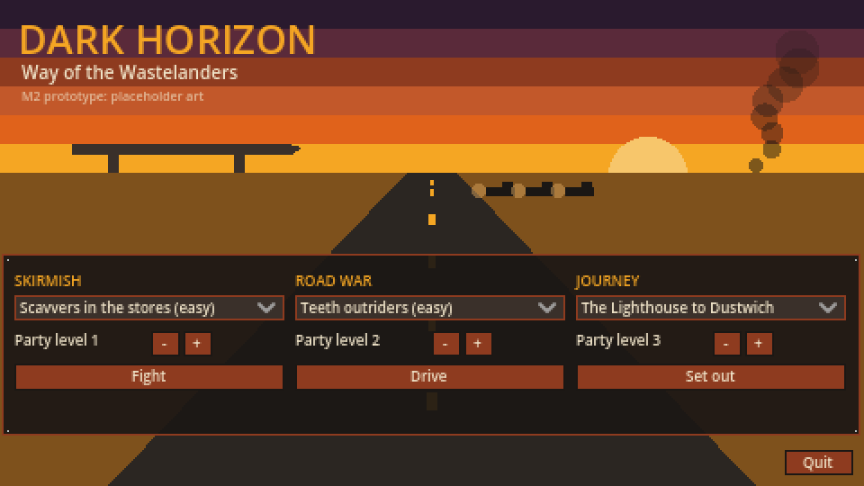
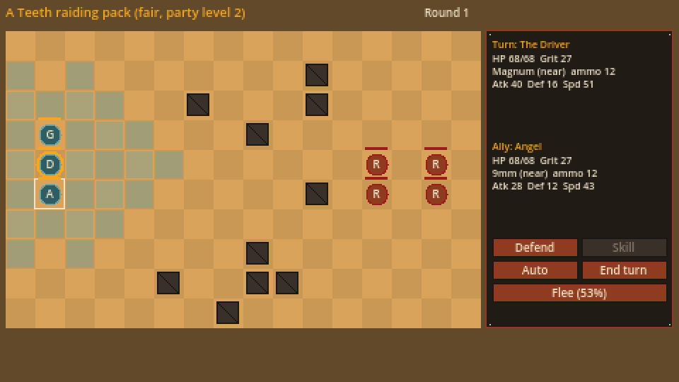
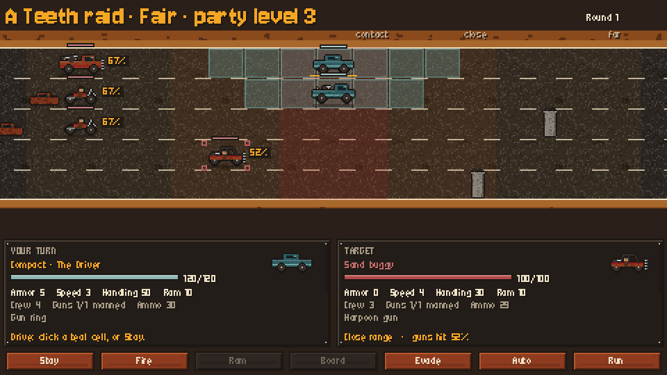
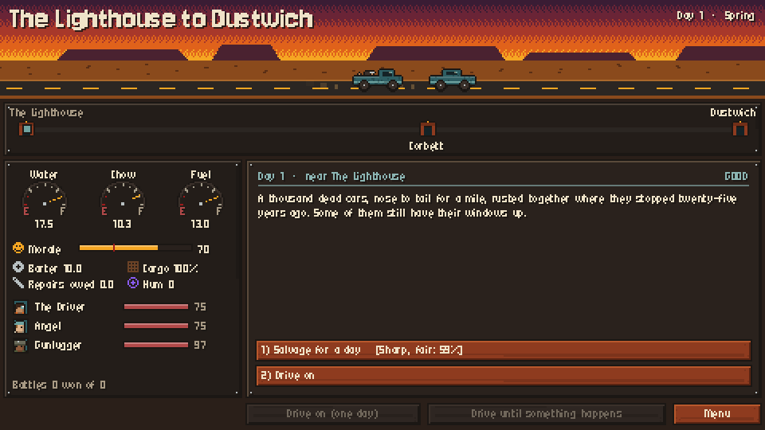

# game/

The playable M2 prototype: a skirmish, a road war and a journey, with **placeholder art drawn in code** from the palette in [doc 14](../docs/design/14-art-audio-ui.md) (a hot world of ochre, rust and bone; the Choir is the only cold, violet thing). Real sprites, portraits and the dashboard come later.

The scenes hold no rules. Each one drives a sim from [`sim/`](../sim/README.md) through its step API and draws it, so a fight played here follows the same rules, and the same AI, as the balance benches. With the AI playing every unit, a scene reaches exactly the result the sim's `run()` reaches (`tests/run_tests.gd` checks it for every encounter and convoy).

| Scene | What it is |
|---|---|
| `main_menu.tscn` | The test menu: pick a skirmish, a road war or a journey (the bench routes), set the party level, play. The project's main scene |
| `skirmish_scene.tscn` | Inindo's grid battle (doc 09) |
| `road_war_scene.tscn` | UWNH's fleet battle on the road: lanes, range bands, the camera following the convoy |
| `journey_scene.tscn` | A route day by day: the route strip, supply gauges, event cards with their check chances, battles to fight or auto-resolve |
| `game.gd` | Shared state (the loaded data, the journey in progress, what the next scene sets up), the palette, the theme and drawing helpers |
| `playtest_log.gd` | The playtest log: every fight, card and journey, and testers' "too easy / about right / too hard", as JSON lines in the user folder. See [playtesting](../docs/playtest/README.md) |






## Controls
**Skirmish.** On a party unit's turn, teal tiles are where it can move (once a turn). Click an enemy in range (its hit chance shows under it) to attack, which ends the turn. Hover a unit to see its stats.
Buttons and keys: **Defend** (D), **Skill** (S: class abilities and disciplines; an attack skill then needs an enemy click), **Auto** (A: the AI plays this unit), **End turn** (Space), **Flee** (F: the whole party; the button shows the chance).

**Road war.** A party rig's turn is *drive, then act*. Drive: click a teal cell (one lane change costs a point of Speed), or **Stay** (Space). Act: **Fire** (F) at the target, **Ram** (R) or **Board** (B) when in contact in the same lane, or **Evade** (E). Click an enemy rig to target it; its gun hit chance, range band and the boarding odds show in the panel. **Auto** (A) lets the AI drive this rig; **Run** makes the whole convoy run for it.

**Journey.** **Drive on** (Space) drives one day; **Drive until something happens** (Enter) drives to the next card, battle or the end. Pick a card's choice with a click or 1–4. A battle can be **fought** (it opens the battle scene, then comes back) or **auto-resolved**.

**After a fight or a journey** the game asks *Too easy / About right / Too hard* for the playtest log. The menu shows how many records the log holds, and **Open log folder** opens it.

## Running
```sh
GODOT=$(tools/get_godot.sh)
"$GODOT" --path .                                   # the menu (a 1440x810 window: 480x270, scaled 3x)
"$GODOT" --path . res://game/skirmish_scene.tscn    # a scene straight away (a default fight)
```
Screenshots without a display (Linux, Xvfb and Mesa):
```sh
xvfb-run -a -s "-screen 0 1280x800x24" "$GODOT" --path . --rendering-driver opengl3 \
    --script res://tools/capture.gd -- skirmish out.png   # also: menu, skirmish_result, road_war, road_war_result, journey_card, journey_end…
```
